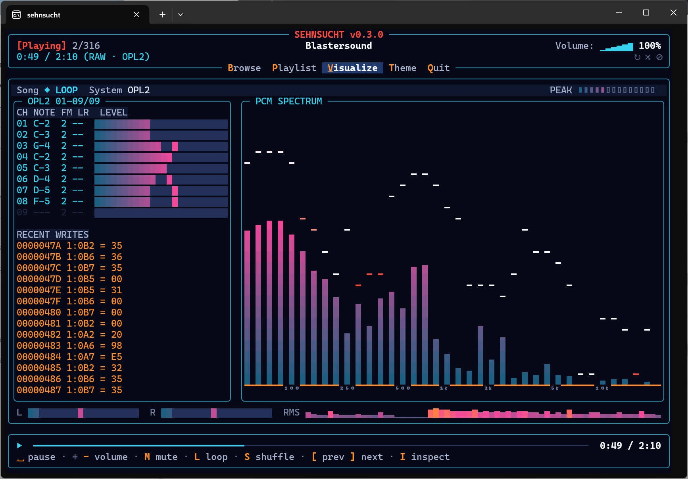
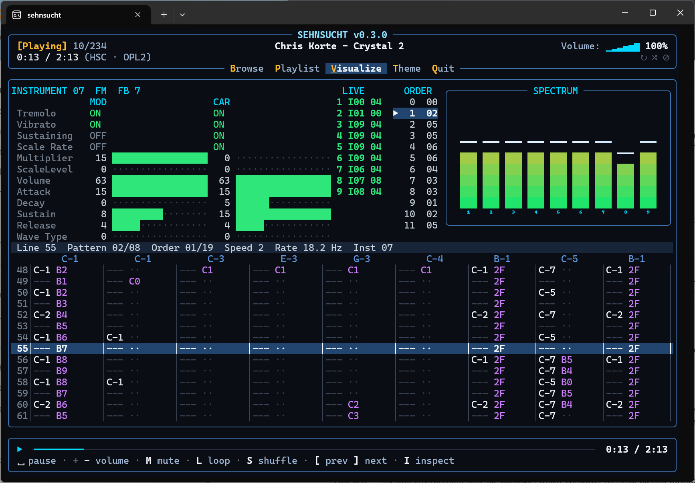
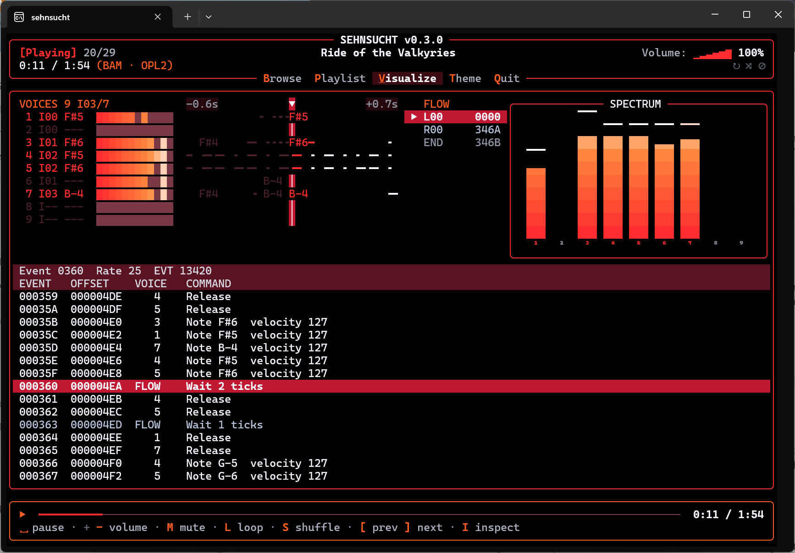

# sehnsucht

A terminal player for classic **OPL2/OPL3** game music.

[](https://github.com/RealBitdancer/sehnsucht/actions/workflows/linux.yml)
[](https://github.com/RealBitdancer/sehnsucht/actions/workflows/macos.yml)
[](https://github.com/RealBitdancer/sehnsucht/actions/workflows/windows.yml)

## What it does

A single file follows its decoder's loop behavior. A non-looping track plays
once, parks at the end, and Space replays it. A multi-entry playlist advances
at each song boundary. With playlist loop off, it parks on the last track.

FM synthesis is [opal](https://github.com/RealBitdancer/opal) via
[opal-zig](https://github.com/RealBitdancer/opal-zig). Audio out is
[zaudio](https://github.com/zig-gamedev/zaudio) (miniaudio). The TUI is
[libvaxis](https://github.com/rockorager/libvaxis).

Every meter and spectrum band comes from chip or PCM state, measured before
output volume and mute. Muting playback does not stop the display.

**Stream visualizer** (DRO, VGM, IMF, and the other stream formats): live OPL
voices beside the PCM spectrum, with stereo meters and recent register writes.
Left/Right pages the hardware voices when the terminal cannot show them all.



**Tracker visualizer** (HSC, HSP, RAD, A2M/A2T, LDS, and XSM): pattern, order list,
instruments, and OPL channel meters.



**Sequence visualizer** (ADL, BAM, CMF, JBM, KSM, LAA, Lucasfilm AD, MusicV,
ROL, SCI0, XMI, and voice programs): channel meters, live notes, spectrum, and
events. BAM, JBM, and MusicV have command lists with byte offsets.



Press **I** in any visualizer for a centered inspection popup with instrument,
macro, event, and chip details. Backtick changes sections. Up and Down scroll,
Left and Right pan, and the mouse wheel scrolls. Escape, I, or the close
button dismisses it.

Themes so far are Cyberpunk, High Contrast, LCD Ink, Midnight Azure (default), Neo Tokyo,
and Tron Ares. T in the menu opens the theme browser.

## Why it exists

I built sehnsucht to put [opal](https://github.com/RealBitdancer/opal) through
a real-world test. The `examples/player` that ships with opal works, but it is
too small to show what the core can do, and so sehnsucht was born.

The name sehnsucht (the German word for longing) is deliberate. It reminds me of
the Amiga and DOS days, when the gaming and demo scenes produced impressive work,
and games were still shining stars of creativity and fun.

## The road ahead

sehnsucht is still in development. I plan to keep adding formats, visualizers,
and themes. The plugin layout is there for that. The goal for 1.0.0 is, at a
minimum, every OPL2/OPL3 format current AdPlug plays. 1.0.0 also aims at
lesser-known OPL formats from older DOS games (see
[doc/retromusic-formats.md](doc/retromusic-formats.md)).
Contributions of the same kind are welcome (see
[CONTRIBUTING.md](CONTRIBUTING.md)).

## Supported formats

sehnsucht registers twenty-three format families. Aliases and compressed wrappers
share their parent decoder. The list, including companion-file requirements,
is in [Supported formats](doc/supported-formats.md).

Plugins: [doc/plugins.md](doc/plugins.md).
Hotkeys and playlist modes:
[doc/hotkeys-and-playlist-modes.md](doc/hotkeys-and-playlist-modes.md).

## Playlists

Pass an `.m3u` or `.m3u8` file instead of a single track. One path per line.
`#` starts a comment. Relative paths resolve against the playlist's location.
Unsupported extensions are dropped.

`#EXTINF` titles name the rows. An `#EXTINF` tag may also carry `rate=280`,
`rate=560`, or `rate=700` for IMF, WLF, and AudioT. That per-entry rate
wins over the extension default and loses to `--rate`. A `theme="Neo Tokyo"`
attribute switches to that theme when the entry starts. Names match in any
case. Unknown names are ignored, and untagged entries keep the current theme.
`#PLAYLIST` names the list on the Playlist view title line. Without that
directive, the playlist file name is used.

Tracks play in order and advance at each song end. Loop (**L**) wraps at
both ends. Off, the list plays through once and parks on the last track.
Space replays that last song. Shuffle (**S**) builds a random order with
no repeats until the list is exhausted. **]** and **[** skip.

Played rows this session dim. Failed loads are marked with ✗ and skipped.
Enter on a marked row retries it. A load failure never quits a running
session.

## Remote files

Any file, playlist, or playlist entry may be an `http://` or `https://` URL.
The bytes download into memory (16 MiB per file, up to five redirects) and play
like a local file. A stall with no bytes for 30 seconds is abandoned. A slow
server that keeps delivering is not.

A playlist entry of the form `archive.zip/inner.ext` is a zip member. The
player GETs that full path first, so Archive.org and DiscMaster keep working
as they do today. If the host returns an error, sehnsucht fetches the zip
and unpacks the member in memory. The zip is cached for later members of
the same archive. The archive and extracted member each have a 16 MiB limit.
Stored and deflated members are supported. ZIP64 is not. Downloads remain in
memory.

Formats with companion banks fetch them beside the song. Named resources
have a combined 64 MiB limit. See the individual
[format guides](doc/formats/README.md) for the candidate names.

Relative entries in a remote playlist resolve against the playlist URL.
Unsupported schemes are dropped. A playlist fetched over http(s) keeps only
http(s) entries.

Percent-encoded names show decoded (`dune%201.dro` as `dune 1.dro`). Fetching
uses the URL as written.

`file://` is a local path, not a download. Drive forms (`file:///C:/...`)
and UNC (`file://host/share`) unwrap the same way.

Downloads run in the background. The header reads `[Loading]`, keys still
work, and skip passes over a slow entry. Starting with a URL opens the UI at
once.

## Building

Requires **Zig 0.17.0** (see `.minimum_zig_version` in `build.zig.zon`).

```sh
zig build                 # -> zig-out/bin/sehnsucht[.exe]
```

Default optimize mode is **safe** (ReleaseSafe before Zig 0.17). Dependencies are fetched on first
build.

The UI uses truecolor (24-bit SGR). It has no 256-color or 16-color palette
fallback. A terminal without truecolor support may display it in monochrome.
Mouse controls require the terminal to report mouse events.

Release archives target x86_64 and aarch64 on Linux, macOS, and Windows.
They include the executable, documentation, license notices, and sample playlists.

## Sample playlists

The lists under `playlists/` contain remote URLs and need network access.
The catalog is in [playlists/playlists.md](playlists/playlists.md).

```sh
zig build run -- playlists/bitdance.m3u
```

## Usage

```sh
sehnsucht [files... | playlist | directory | URL]
sehnsucht                       # Browse view in the current directory
sehnsucht ~/adlib               # Browse view in the given directory
sehnsucht favorites.m3u         # Playlist view, plays the first entry
sehnsucht a.hsc b.vgm c.dro     # several files become a playlist
sehnsucht https://example.com/tune.vgz
sehnsucht --rate 700 tune.imf
sehnsucht --track 2 AUDIOT.WL6
sehnsucht --version           # -v works too
sehnsucht --help              # -h works too
```

A playlist or directory must be the only argument. Wildcards are the shell's
job, so cmd.exe users must list files explicitly.

`--track` selects a one-based member of an AudioT, ADL, or XMI archive. An index
beyond the last member selects the last member.

### In-player keys

Transport keys are the ones the status frame shows. They work from every view
and every focus state. Nothing else in the player binds them.

| Key | Action |
|-----|--------|
| Space | Pause / resume. Replays a parked one-shot or the last song of a finished playlist pass |
| + / - | Volume up / down, 2.4 dB per press (`=` is also `+`) |
| M | Mute / unmute |
| R | Cycle IMF/WLF/AudioT tick rate 280 → 560 → 700 (rate-adjustable sources only). Replay and archive steps keep the choice |
| `,` / `.` | Previous / next music track in an AudioT, ADL, or XMI archive (multi-track only) |
| `]` | Next track (playlists only) |
| `[` | Previous track (playlists only) |
| S | Toggle shuffle (playlists) |
| L | Toggle playlist loop |

Everything else is shell navigation.

| Key | Action |
|-----|--------|
| Ctrl+C or Alt+Q | Quit |
| F10 or Alt | Toggle menu focus |
| Alt+B / Alt+P / Alt+V / Alt+T | Activate a menu item directly |
| B (menu focused) | Browse filesystem |
| P (menu focused) | Playlist list view |
| V (menu focused) | Visualizer view |
| T (menu focused) | Open the theme browser |
| Q (menu focused) | Quit |
| Tab / Shift+Tab | Open the next / previous menu view, or focus action-only items |
| ← / → | Parent dir / open selection (Browse, like ranger), or move menu focus. On Windows, parent from a drive root opens a Drives list |
| ↑ / ↓ | Move list cursor (Browse, Playlist, Theme) |
| PgUp / PgDn | Page list cursor (Browse, Playlist, Theme) |
| Home / End | First / last list entry (Browse, Playlist, Theme) |
| Enter | Open dir / play file (Browse), play track (Playlist), apply theme (Theme), or activate the focused menu item |
| Backspace | Parent directory (Browse) |
| I | Open or close the inspector |
| Backtick | Cycle inspector sections, or tracker regions |

Where the terminal reports mouse events, click a menu item to open it, click a
list row to select it, click the selected row again to open or play it, and
scroll lists with the wheel. Click or drag the progress bar to seek. The
controls in the bottom status bar and the Browse, Playlist, and Theme footers
are clickable. Disabled or hidden controls
do not respond. Inspect dims the background and captures clicks until closed.

## License

MIT. See [LICENSE](LICENSE). Copyright (c) 2026 Bitdancer
(github.com/RealBitdancer).

Third-party code (opal, libvaxis, zaudio/miniaudio) is summarized in
[THIRD_PARTY_LICENSES.md](THIRD_PARTY_LICENSES.md).
